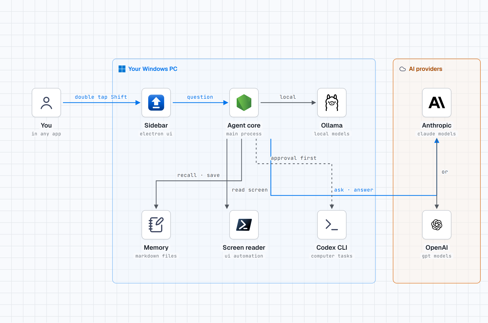

# ShiftSense

**A screen aware AI sidebar for Windows.**

Double tap **Shift** anywhere on your PC, ask a question, and ShiftSense answers using the app on your screen, your local markdown memory, and the AI provider you choose. It stays lightweight in the system tray, opens without stealing focus, and closes with **Esc**.

[](https://github.com/anilkumara9/shiftsense/releases)
[](https://github.com/anilkumara9/shiftsense/actions/workflows/ci.yml)
[](https://github.com/anilkumara9/shiftsense/stargazers)
[](LICENSE)
[](#prerequisites)

---

## Overview

ShiftSense is built for quick questions while you work. Instead of switching to a browser tab and explaining again what you are looking at, you open the sidebar, ask naturally, and get an answer grounded in the current window.

It reads the screen through Windows UI Automation first, uses a screenshot only when the accessible text is not enough, and keeps your long term memory as plain markdown files that you can open, edit, back up, or delete at any time.

## How it works

<picture>
  <source media="(prefers-color-scheme: dark)" srcset="docs/flow-diagram-dark.png">
  
</picture>

1. **Ask from anywhere.** Double tap Shift in any app and the sidebar opens beside your work, without stealing focus.
2. **It reads the app in front of you.** The screen reader uses Windows UI Automation to read the window as structured text. A screenshot is taken only when the text is not enough, and never more than one per question.
3. **It remembers what matters.** Your markdown memory is searched for anything relevant, and what it finds is added to your question.
4. **Your model answers.** The question goes to the provider you chose: Anthropic, OpenAI, or Ollama running locally on your PC. The answer streams into the sidebar.
5. **Acting needs your approval.** If a task needs the computer itself, the Codex handoff waits for your approval first, every time.

You can also open the diagram as a [standalone page](docs/flow-diagram.html) in any browser.

## Why ShiftSense

**Because the answer should come to where you already are.** Normally, getting AI help with something on your screen means switching apps, taking a screenshot or copying text, pasting it into a chat tab, and explaining the background before you can even ask. ShiftSense removes all of that:

- **No need to explain everything again.** It already sees the window you are asking about and knows your context from your memory files, so you can ask the way you would ask a person sitting next to you.
- **No copy and paste.** Errors, emails, documents, dashboards: ask about them in place, in any app, without moving content around.
- **It remembers you.** Your memory lives in plain markdown files on your PC and your chats persist between sessions, so answers stay personal instead of starting from zero every time.
- **Your model, your cost.** Use Claude, OpenAI, or a free local model through Ollama. You see token and cost stats per chat, and a daily budget cap protects you from surprises. There is no ShiftSense subscription.
- **Private by design.** Memory and history never leave your machine. Password fields are never read, sensitive apps can be blocked from reading entirely, and with Ollama nothing leaves your PC at all.
- **Help that acts, with your permission.** When a task needs the computer itself, ShiftSense asks first, every time. Approvals expire in 2 minutes and there is no always allow switch.
- **Free and open source.** Download it, inspect it, keep it forever.

## Where it helps

- **When something breaks:** an error dialog, a failed build, a cryptic stack trace. Ask "what is this and how do I fix it" without leaving the app that failed.
- **In your inbox:** summarize a long thread, draft a reply to the email on screen, or pull out the action items.
- **While you study or research:** explain the paragraph, table, or chart in front of you, in plain words, with your project context remembered.
- **In documents and spreadsheets:** compare the options visible in a window, extract the key points of a long document, or check what a report is really saying.
- **At work:** meeting notes, dashboards, forms, and admin panels. Ask what matters on the page instead of reading every field.
- **While you write:** tighten a draft, change its tone, or continue it, using the text already on your screen.
- **For anything you ask twice:** if you find yourself retyping the same background into a chat window every day, that background belongs in your memory file, where ShiftSense keeps it for you.

## Features

### Sidebar experience

- Double tap **Shift** to open the sidebar from anywhere.
- Translucent floating panel that appears over your current app.
- Does not steal focus while peeking; click into the composer when you want to type.
- **Esc** closes the sidebar.
- Fallback shortcut: **Ctrl+Shift+Space**.
- Multiple chat tabs with persistent history.
- Token, cache, context and estimated cost stats for each tab.
- System tray controls for showing/hiding the app, opening memory, changing provider, and updating settings.

### Screen understanding

- Context is accessibility first, read through Windows UI Automation.
- Reads the foreground app window, focused element, selected text, controls, labels and visible text.
- Hard caps keep screen context fast and predictable.
- Screenshot fallback is limited and used only when the UI Automation tree is missing, too thin, or the model explicitly needs visual context.
- Password values are never read.
- Sensitive apps can be placed on a no read list.

### Local memory

- Memory is stored as normal markdown files.
- Default location: `~/DShift/memory/`.
- Includes `me.md`, `notes.md`, `people/` and `projects/`.
- Ranked memory search inside the app.
- Model memory writes are audit logged, and you can undo them.
- You can edit every memory file in any text editor.

### Providers and cost control

- Anthropic Claude models.
- OpenAI models.
- Ollama for local models and offline chat.
- Model choice for each tab.
- Editable pricing table.
- Daily budget tracking with reserve/settle protection for concurrent tabs.
- Streaming safeguards: retry handling, stall watchdog and a time budget for each turn.

### Optional computer use handoff

- Optional Codex CLI handoff for approved tasks.
- Every task requires explicit approval.
- Approvals expire after 2 minutes.
- No persistent always allow mode.
- Tasks run with a scrubbed environment and an audit trail.

### Reliability and safety

- Local state is crash safe, thanks to atomic writes, backups and mirror recovery.
- Audit logs for memory writes and Codex tasks are tamper evident and hash chained.
- Settings validation and encrypted API key storage in the app, using Windows DPAPI.
- Test suite covers the agent loop, memory, approvals, screen context, security rules, persistence, provider streaming and end to end failure cases.

---

## Download and install

### Option 1: Install the release build

1. Open the latest release: <https://github.com/anilkumara9/shiftsense/releases/latest>
2. Download the Windows installer, currently named like:

   ```text
   D-Shift-Setup-1.5.0-x64.exe
   ```

3. Run the installer.
4. Launch ShiftSense from the Start menu or system tray.
5. Double tap **Shift** to open the sidebar.

> The installer is not code signed yet. If Windows SmartScreen appears, confirm that you downloaded the file from the official GitHub release page, then choose **More info → Run anyway** if you trust the source.

#### Verify your download (recommended)

Every release includes a `SHA256SUMS.txt` file next to the installer. Download it into the same folder, then run:

```powershell
(Get-FileHash .\D-Shift-Setup-1.5.0-x64.exe -Algorithm SHA256).Hash
Get-Content .\SHA256SUMS.txt
```

The two hashes must match exactly. If they do not, delete the installer and download it again from the official release page.

### Option 2: Run from source

Use this option for development or if you want to inspect and modify the code before running it.

#### Prerequisites

| Requirement | Notes |
|---|---|
| Windows 10 or Windows 11 | Required for the packaged Windows experience, UI Automation and DPAPI key storage. |
| Node.js 20 or newer | Required to run from source and to build the installer. |
| npm | Included with Node.js. |
| Git | Required only for cloning the repository. |
| An AI provider | Anthropic key, OpenAI key, or Ollama installed locally. |
| Codex CLI | Optional. Only needed for computer use through the Codex handoff, which asks for your approval first. |

#### Clone and start

```powershell
git clone https://github.com/anilkumara9/shiftsense.git
cd shiftsense
npm install
npm start
```

On first launch, look for the ShiftSense tray icon. Double tap **Shift** or press **Ctrl+Shift+Space** to open the sidebar.

---

## Configuration

ShiftSense works without a `.env` file. The recommended setup is to paste your API key inside the app Settings, where it is stored as Windows DPAPI ciphertext.

### API key resolution order

ShiftSense checks for provider keys in this order:

1. Real environment variables.
2. `./.env` in the project folder.
3. `~/.config/dshift/.env`.
4. The encrypted key stored in the app, saved from Settings.

### Provider setup

| Provider | What to configure | Notes |
|---|---|---|
| Anthropic | `ANTHROPIC_API_KEY` or the Anthropic key field in the app | Default provider. Get a key from the Anthropic Console. |
| OpenAI | `OPENAI_API_KEY` or the OpenAI key field in the app | Switch the provider in Settings or from the tray menu. |
| Ollama | No API key | Install Ollama, pull a model, then switch the provider to Ollama in the app. |

### Optional `.env` setup

Copy the example file if you prefer file based configuration:

```powershell
Copy-Item .env.example .env
notepad .env
```

Example:

```dotenv
ANTHROPIC_API_KEY=sk-ant-...
# OPENAI_API_KEY=sk-...
# DSHIFT_DATA_DIR=C:\Users\you\Documents\ShiftSense
```

Never commit a real `.env` file. The repository ignores it, and the packaging preflight blocks files that look like they hold a key from being included in builds.

### Change the data folder

By default, ShiftSense stores local data in:

```text
~/DShift
```

To use a different folder, set `DSHIFT_DATA_DIR` before launching the app:

```powershell
$env:DSHIFT_DATA_DIR = "C:\Users\you\Documents\ShiftSense"
npm start
```

For an installed build, set the variable in Windows Environment Variables and restart ShiftSense.

---

## How to use

| Action | How |
|---|---|
| Open the sidebar | Double tap **Shift** or press **Ctrl+Shift+Space**. |
| Close the sidebar | Press **Esc**. |
| Ask about the current app | Open the sidebar and type your question. ShiftSense attaches screen context automatically. |
| Open a new tab | Use the **+** button or **Ctrl+T**. |
| Close a tab | Use the tab close button or **Ctrl+W**. |
| Reopen a previous chat | Use the history control in the sidebar. |
| Open memory | Use the memory button, the tray menu, or `/memory`. |
| Copy the last answer | Use `/copy`. |
| Clear the current chat | Use `/clear`. |
| Toggle session auto mode | Use `/auto`. This lasts for the current session only. |
| See available commands | Use `/help`. |

Useful questions to try:

- "Summarize what is on this page."
- "What is this error and how do I fix it?"
- "Draft a reply to this email."
- "Compare the options visible in this window."
- "Remember that this project uses the staging API."

---

## Data, privacy and security

ShiftSense is local first. Your memory, chat history, settings and audit files stay on your machine unless you send a question to a configured cloud provider.

### Local data layout

```text
~/DShift/
├── memory/
│   ├── me.md
│   ├── notes.md
│   ├── people/
│   ├── projects/
│   ├── .audit.jsonl
│   └── .versions/
├── history/
├── chats.json
├── chats.json.bak
├── chats.json.mirror
├── settings.json
├── spend.json
└── codex/
```

### What leaves your machine

When you ask a question using Anthropic or OpenAI, ShiftSense sends the prompt, the relevant screen context, the `me.md` memory excerpt and the memory file list to that provider. If a screenshot is needed, that screenshot is also sent for that question.

When you use Ollama, chat runs against your local model. Screen text stays on your machine in that mode unless you separately choose a cloud backed tool or provider.

### Protections built in

- Password fields are redacted and never emitted as values.
- Apps on the no read list are not read.
- Memory writes are confined to the memory folder.
- Memory writes are size capped, audit logged and undoable.
- Codex tasks require approval and receive a scrubbed environment without provider API keys.
- API keys saved in the app are encrypted with Windows DPAPI.
- Local state files use atomic writes with backup and mirror recovery.

For vulnerability reporting and the security model, see [SECURITY.md](SECURITY.md).

---

## Development

### Common commands

| Command | Purpose |
|---|---|
| `npm start` | Run the app in development. |
| `npm run check` | Syntax check the main process, preload, renderer, source and scripts. |
| `npm test` | Run the full test suite. |
| `npm run stress` | Run the heavy load stress suite. |
| `npm run preflight` | Run packaging safety and completeness checks. |
| `npm run icon` | Regenerate the app icons. |
| `npm run shot` | Capture a local UI screenshot for development checks. |
| `npm run dist:win` | Build the Windows NSIS installer into `dist/`. |
| `npm run dist:win:portable` | Build a portable Windows executable into `dist/`. |

### Project structure

```text
├── main.js                 Electron main process: window, tray, shortcuts, IPC and key storage
├── preload.js              Secure renderer bridge with context isolation
├── renderer/               Sidebar user interface
├── src/                    Tested application core
│   ├── agent.js            Tool loop and turn orchestration
│   ├── approvalQueue.js    Serialized user approvals
│   ├── chatStore.js        Tabs, transcripts, archive and crash safe persistence
│   ├── codex.js            Approval gated Codex handoff
│   ├── contextEngine.js    UI Automation tree serialization and safety caps
│   ├── doubleShift.js      Double tap Shift detection state machine
│   ├── llm.js              Anthropic, OpenAI and Ollama streaming clients
│   ├── memory.js           Markdown memory store, search, audit chain and undo
│   ├── settings.js         Settings validation and API key resolution
│   ├── shellPolicy.js      Defence in depth shell policy
│   ├── spend.js            Daily budget ledger
│   ├── uiaClient.js        Persistent UI Automation host client
│   └── usage.js            Token, cache and cost accounting
├── native/                 PowerShell UI Automation readers for Windows
├── tests/                  Unit, security, reliability and end to end tests
├── scripts/                Check, test, stress, preflight, icon and screenshot tools
├── docs/                   Architecture, memory and tool documentation
├── build/                  Application icons
├── .github/                Issue templates, pull request template and GitHub Actions workflows
├── .env.example            Documented environment variable template
├── CHANGELOG.md            Release history
├── CONTRIBUTING.md         Development rules and contribution guide
└── SECURITY.md             Security model and reporting process
```

More detail:

- [Architecture](docs/architecture.md)
- [Memory](docs/memory.md)
- [Tools](docs/tools.md)
- [Contributing](CONTRIBUTING.md)
- [Changelog](CHANGELOG.md)

### Build the Windows installer locally

```powershell
npm install
npm test
npm run preflight
npm run dist:win
```

The installer is written to `dist/`.

### Release process

Releases are built by GitHub Actions on a Windows runner. Pushing a version tag such as `v1.5.0` runs the test suite, packaging preflight and installer build, then publishes the GitHub release with the generated `.exe` attached.

---

## Troubleshooting

### The sidebar does not open

- Check that ShiftSense is running in the system tray.
- Try the fallback shortcut: **Ctrl+Shift+Space**.
- Click the tray icon and use **Show/Hide**.
- Restart the app if the global hook stopped responding.

### The app asks for an API key

- Paste an Anthropic or OpenAI key in Settings, or
- create a `.env` file from `.env.example`, or
- switch the provider to Ollama for local models.

### Answers do not include screen context

- Make sure the target app is the foreground window before opening ShiftSense.
- Some apps expose very little UI Automation text; ShiftSense may need the screenshot fallback.
- Check whether the app is on the no read list in Settings.
- Password managers and protected windows may intentionally expose no readable content.

### Ollama does not respond

- Confirm Ollama is running locally.
- Confirm at least one model is installed.
- Select Ollama as the provider in ShiftSense Settings or the tray menu.

### Codex handoff is unavailable

- Install the Codex CLI separately.
- Make sure it is available from a normal absolute install location or PATH entry.
- Remember that each computer use task still needs your approval inside ShiftSense.

### The installer shows a SmartScreen warning

The current installer is unsigned. Only continue if the file came from the official ShiftSense GitHub release page and the filename/version match the release you intended to download.

---

## Contributing

Contributions are welcome. Please read [CONTRIBUTING.md](CONTRIBUTING.md) before opening a pull request, and keep the project rules intact: approvals must always resolve, screen context must never read the sidebar itself, memory writes must stay inside the memory folder, persisted state must be crash safe, and placeholder/demo features do not ship.

## License

Released under the [MIT License](LICENSE).

---

## ⭐ Star progress

If ShiftSense is useful to you, please star the repository. Stars help other Windows users discover the project and make it easier to track real adoption over time.

[](https://star-history.com/#anilkumara9/shiftsense&Date)
